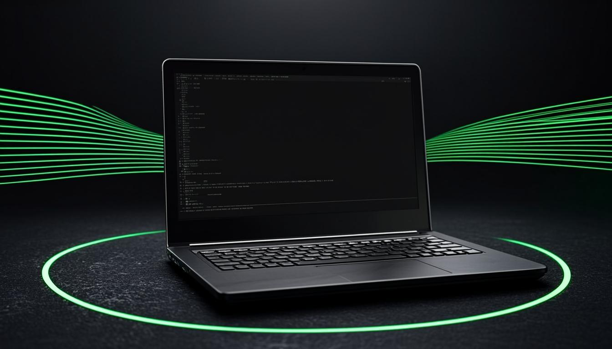
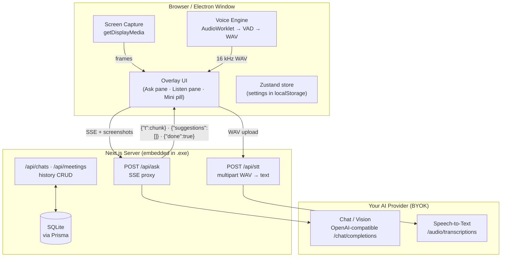

<div align="center">


# NYAKSAI

### One overlay. No tab. No taskbar icon. No trace on screen share.

**Your invisible AI over everything on your screen — ask about anything you see, listen to any conversation, get the right answer before you need it.**

[](https://nextjs.org)
[](https://react.dev)
[](https://typescriptlang.org)
[](https://electronjs.org)
[](https://prisma.io)
[](https://tailwindcss.com)
[-10B981?style=flat-square)](#-ai-backend--bring-your-own-key)
[](#-license)

`⌘/Ctrl+X` capture · `⌘/Ctrl+B` vanish · `Esc` panic-hide

</div>

---

<div align="center">
  
</div>

---

## 📑 Table of Contents

- [What is Nyaksai?](#-what-is-nyaksai)
- [Feature Matrix](#-feature-matrix)
- [Architecture](#%EF%B8%8F-architecture)
- [The Three Layers of Stealth](#-the-three-layers-of-stealth)
- [Quick Start — Web App](#-quick-start--web-app)
- [Quick Start — Invisible Desktop Shell](#-quick-start--invisible-desktop-shell)
- [Package into a Single .exe (Windows)](#-package-into-a-single-exe-windows)
- [AI Backend — Bring Your Own Key](#-ai-backend--bring-your-own-key)
- [API Reference](#-api-reference)
- [Keyboard Shortcuts](#%EF%B8%8F-keyboard-shortcuts)
- [Data & Privacy](#-data--privacy)
- [Project Structure](#-project-structure)
- [Troubleshooting](#-troubleshooting)
- [FAQ](#-faq)
- [Honest Limitations](#-honest-limitations)
- [Responsible Use](#-responsible-use)
- [Credits & Attribution](#-credits--attribution)
- [License](#-license)

---

## 🎯 What is Nyaksai?

Nyaksai is a **floating, translucent AI assistant that lives *above* whatever you're doing** — a coding interview, a sales call, a lecture, a live-debugging session. It reads your screen, hears the conversation, and streams the right answer back in real time.

There is **no tab to alt-tab into, no window in your taskbar, and no trace in screen shares, recordings, or screenshots.** Task managers, window switchers, and the person on the other end of the call see nothing. You see everything.

### Two modes, one overlay

| | Mode | What it does |
|---|---|---|
| 🔍 | **Ask** | Capture the screen (`⌘/Ctrl+X`), ask anything, get a **streamed Markdown + LaTeX answer** token-by-token, with AI-generated follow-up suggestion chips. |
| 🎧 | **Listen** | Live transcription of **your microphone** and **the other side of the call**, speaker-labelled, with automatic answer suggestions as questions come in. |

> Think of it as a chat assistant that refuses to be a tab: the model sees what your meeting app shows, hears what the call hears, and the answer appears over your work — while everything else sees nothing.

<div align="center">
  <sub> Nyaksai is an independent re-implementation inspired by <a href="https://github.com/iamsrikanthnani/pluely">Pluely</a> by Srikanth Nani. </sub>
</div>

---

## ✨ Feature Matrix

### Core experience

| Feature | Details |
|---|---|
| 🖥️ **Screen understanding** | Full-window capture via `getDisplayMedia`, frames sent to a vision model. Screenshot strip preview before sending, `Use image` toggle. |
| 📡 **True SSE streaming** | Answers render **token-by-token** — the server pipes the upstream model stream and re-emits typed frames. No typewriter faking. |
| 🧠 **Follow-up suggestions** | A second short model call turns each answer into clickable follow-up chips. |
| 🎙️ **Real voice engine** | AudioWorklet PCM capture (ScriptProcessor fallback) → adaptive energy VAD (noise-floor learning, hysteresis, 0.6 s pre-buffer, 47 s max utterance) → 16 kHz 16-bit WAV → STT. |
| 👥 **Two audio sources** | `Mic — you` and `System — them` (shared-tab audio). Interim text, speaker labels, live FFT visualizer. |
| 🤖 **Auto-responses** | Four modes: on-question / after-pause / manual / off, with configurable pause delay. |
| 💬 **Rich answers** | GitHub-flavored Markdown, KaTeX math, syntax-highlighted code, copy button, abort-stream button. |
| 🎨 **Stealth UI** | Translucent, blurred, draggable overlay; adjustable opacity; re-centers on narrow viewports (works at 390 px). |
| 💾 **Local history** | Ask sessions + Listen meetings stored in SQLite via Prisma, deletable from the history drawer. |
| 🔧 **Deep settings** | Editable system prompts, language, response style, overlay opacity, VAD sensitivity — persisted via Zustand. |
| 📦 **Self-contained .exe** | Whole Next.js server + UI + SQLite bundled into one executable. No Node.js, no dev server, no project folder. |

### Stealth capabilities

| Capability | Web | Desktop Shell (.exe) |
|---|:---:|:---:|
| Translucent blur overlay | ✅ | ✅ |
| Mini pill (`⌘/Ctrl+B`) | ✅ | — (window-level hide) |
| Panic dot (`Esc`) | ✅ | — (window-level hide) |
| Hidden from taskbar / Dock | — | ✅ `skipTaskbar` |
| Hidden from screen share & recording | — | ✅ `setContentProtection` |
| Always on top, above fullscreen | — | ✅ `screen-saver` level |
| Never steals keyboard focus | — | ✅ `showInactive()` |
| Global hotkeys (any focused app) | — | ✅ |
| Single instance | — | ✅ |

---

## 🏗️ Architecture



**How a question flows:**

1. `⌘/Ctrl+X` captures the visible screen → frames queue in a preview strip.
2. The Ask pane posts your prompt (+ optional screenshot) to `/api/ask`.
3. `/api/ask` calls **your** configured OpenAI-compatible endpoint with `stream: true`, re-emitting the upstream stream as typed SSE frames.
4. The overlay renders deltas instantly; a follow-up call appends suggestion chips.
5. The finished exchange persists to `ChatSession` in SQLite.

---

## 🥷 The Three Layers of Stealth

Stealth in Nyaksai is layered, from cosmetic to OS-enforced:

```
Layer 1  UI stealth        translucent blur overlay that melts into any background
Layer 2  UX stealth        ⌘/Ctrl+B mini pill  ·  Esc panic-hide to invisible dot
Layer 3  OS stealth  ★     Electron window flags — the layer a browser tab cannot provide
```

### Layer 3 — what the desktop shell actually sets

| Flag | Effect | OS mechanism |
|---|---|---|
| `setContentProtection(true)` | Excluded from screen shares, recordings & screenshots | **Windows:** `SetWindowDisplayAffinity(WDA_EXCLUDEFROMCAPTURE)` (Win 10 2004+) — skipped by Zoom, Meet, Teams, OBS capture paths. **macOS:** `NSWindowSharingType = .none` — never appears in CGWindowList / ScreenCaptureKit. |
| `skipTaskbar: true` | No taskbar icon (Win/Linux), removed from Dock (macOS) | `app.dock.hide()` on macOS |
| `frame: false` + `transparent: true` | Frameless translucent overlay | Compositor-composited window |
| `alwaysOnTop` (`screen-saver` level) | Floats above fullscreen meeting apps | Highest z-order level |
| `showInactive()` | Never steals keyboard focus | Window shown without activation |
| `setVisibleOnAllWorkspaces(true)` | Visible on every virtual desktop & fullscreen space | Per-platform workspace APIs |

**Additional shell behavior:** single instance · auto-granted mic/camera/capture permissions · no menu bar · `contextIsolation: true`, `nodeIntegration: false` · preload exposes exactly one bridge (`window.nyaksai = { desktop, platform, onCapture }`) · `backgroundThrottling: false` keeps streams and audio alive while hidden · global shortcuts unregistered on quit.

---

## 🚀 Quick Start — Web App

> The web app alone gives you **every feature** — overlay, capture, voice, history. The desktop shell only adds OS-level invisibility.

### Prerequisites

| | Requirement |
|---|---|
| Node.js | **20+** (or Bun 1.2+) |
| Disk | ~500 MB after install |

### Install & run

```bash
# 1 — install dependencies
npm install            # or: bun install

# 2 — configure the database
cp .env.example .env   # SQLite DATABASE_URL (default: db/custom.db)

# 3 — create the schema
npx prisma db push

# 4 — start
npm run dev            # → http://localhost:3000
```

### 60-second tour

1. Press `⌘/Ctrl+X` → the fake interview backdrop is captured.
2. Ask *"optimize this"* → watch the answer stream token-by-token with follow-up chips.
3. Hit `⌘/Ctrl+B` → collapse to the mini pill. Press `Esc` → panic-hide to an invisible dot.
4. Open **Listen** tab, allow mic, speak → speaker-labelled transcript + live visualizer.
5. `⌘/Ctrl+,` → settings: system prompts, language, response style, opacity, VAD sensitivity.

> Notes: history starts empty (first question creates a chat; stopping Listen saves a meeting). If you later change the Prisma schema, re-run `npx prisma db push` and restart.

---

## 🖥️ Quick Start — Invisible Desktop Shell

A browser tab **cannot** hide itself from screen capture — an OS-level window flag is required. That's what `desktop/` is for: it loads the web app into a native window with the flags from the [stealth table](#layer-3--what-the-desktop-shell-actually-sets).

```bash
# with the web app running on http://localhost:3000
cd desktop
npm install
npm start
```

```bash
# web app on another port? point the shell at it:
NYAKSAI_URL=http://localhost:4000 npm start

# or at any deployed instance:
NYAKSAI_URL=https://your-nyaksai.example.com npm start
```

The shell is a native wrapper around the same web UI — keep the web app running while you use it. Closing the shell window quits the app.

### Per-OS notes

| OS | Notes |
|---|---|
| **macOS** | Grant **Screen Recording + Microphone** on first capture (System Settings → Privacy & Security). Without Screen Recording, frames come back empty. |
| **Windows** | Capture protection needs **Windows 10 2004+** (`WDA_EXCLUDEFROMCAPTURE`); older builds fall back to a dimmed window in shares. |
| **Linux (X11)** | Capture exclusion is often **NOT** honored by compositors. Wayland varies by compositor. |

---

## 📦 Package into a Single .exe (Windows)

Pluely ships as one self-contained executable. Nyaksai packages the same way — the **entire Next.js server, UI and SQLite database are bundled into one .exe**. No Node.js, no dev server, no project folder on the machine it runs on.

### Build on your Windows laptop

> Requires Node.js 20+. First build downloads ~120 MB of Electron/builder binaries; later builds are fast.

```bash
# from the project root
cd desktop
npm install     # first time only
npm run dist    # builds the embedded server, then packages Windows targets
```

### Output — `desktop/dist/`

| File | What it is |
|---|---|
| `Nyaksai-Setup-1.0.0.exe` | Standard installer — choose install dir, Start-menu entry |
| `Nyaksai-Portable-1.0.0.exe` | **One portable file** — copy anywhere, double-click, done |

### How the packaged app works

- `npm run dist` first runs `prepare-server.js`: `prisma generate` → `prisma db push` → `next build` (standalone) → assembles `desktop/resources/next-server` (server.js + traced node_modules + static assets) and a first-run database template.
- `electron-builder` wraps the shell + that bundle into the targets above (`asar` on, NSIS + portable).
- On launch, the exe starts the embedded server on a **free local port** using Electron's own Node binary (`ELECTRON_RUN_AS_NODE` — nothing to install), points the invisible window at it.
- The SQLite database lives at `%APPDATA%\Nyaksai\nyaksai.db`, created from the bundled template on first run.
- All stealth flags are identical. Your AI keys live in the app's localStorage — never inside the exe.
- Closing the window quits the app and the embedded server with it.

### Other platforms & variants

```bash
npm run dist:dir     # quick smoke test → desktop/dist/win-unpacked/Nyaksai.exe
npm run dist:mac     # macOS .dmg   (must run on macOS)
npm run dist:linux   # Linux AppImage (must run on Linux)
```

> **Windows SmartScreen "unknown publisher"** is normal for unsigned builds → *More info → Run anyway*.
> Reset the packaged app's database: delete `%APPDATA%\Nyaksai\nyaksai.db`.
> `npm start` (dev mode) still works exactly as before — it prefers the embedded server if you've run `npm run prepare-server`, otherwise it loads `NYAKSAI_URL` (default `http://localhost:3000`).

---

## 🔑 AI Backend — Bring Your Own Key

Nyaksai ships **no built-in models**. You connect your own OpenAI-compatible provider — your keys, your provider, your costs.

### Setup

Open **Settings → Model — connect your own provider** and fill in:

| Field | Value | Example |
|---|---|---|
| **Base URL** | Provider's OpenAI-compatible endpoint | `https://api.groq.com/openai/v1` |
| **API Key** | Secret from your provider's console | `gsk_...` for Groq |
| **Chat model** | Text model (vision-capable if you want screenshots) | `openai/gpt-oss-120b` |
| **STT model** | Transcription model | `whisper-1` / `whisper-large-v3` |

### Known-good providers

| Provider | Base URL | Chat model example | STT model |
|---|---|---|---|
| **Groq** | `https://api.groq.com/openai/v1` | `openai/gpt-oss-120b` (text only — no screenshots) | `whisper-large-v3` |
| **OpenAI** | `https://api.openai.com/v1` | `gpt-4o` | `whisper-1` |
| **OpenRouter** | `https://openrouter.ai/api/v1` | any vision model | provider-dependent |
| **Ollama (local, free)** | `http://localhost:11434/v1` | `llama3.2-vision` | — |

> ⚠️ **Screenshot reading requires a vision-capable model.** For a free setup on Groq: create an account at [console.groq.com](https://console.groq.com), create an API key (`gsk_...`), then use base URL `https://api.groq.com/openai/v1` + chat model `openai/gpt-oss-120b` + STT model `whisper-large-v3`. Chat and voice work; for screenshot analysis use a vision model from OpenAI, OpenRouter or Ollama.
> Model names change often — check [console.groq.com/docs/models](https://console.groq.com/docs/models) for the current list.

### Where your keys go

Keys live **only in your browser's localStorage** and are sent only to **your own** backend routes, which forward requests to the provider you configured. They never touch any third party. `/api/stt` accepts a multipart WAV upload (or base64 JSON) with a 25 MB guard — over 12 minutes of 16 kHz mono audio, far above the engine's 47 s max utterance.

---

## 🔌 API Reference

All endpoints are local-first — there is no cloud component.

| Endpoint | Method | Purpose | Notes |
|---|---|---|---|
| `/api/ask` | `POST` | Streamed answers (text + vision + follow-up chips) | SSE frames: `{"t":chunk}` deltas · `{"suggestions":[…]}` · `{"done":true}` |
| `/api/stt` | `POST` | Speech-to-text | multipart WAV or base64 JSON · 25 MB guard |
| `/api/chats` | `GET` / `POST` / `DELETE` | Ask history CRUD | `ChatSession` rows |
| `/api/meetings` | `GET` / `POST` / `DELETE` | Listen history CRUD | `Meeting` rows |

**Example — streaming a question:**

```bash
curl -N -X POST http://localhost:3000/api/ask \
  -H "Content-Type: application/json" \
  -d '{
    "messages": [{ "role": "user", "text": "optimize this" }],
    "provider": {
      "baseUrl": "https://api.groq.com/openai/v1",
      "apiKey": "YOUR_KEY",
      "chatModel": "openai/gpt-oss-120b"
    }
  }'
```

---

## ⌨️ Keyboard Shortcuts

| Shortcut | Action |
|---|---|
| `⌘`/`Ctrl` + `X` | Capture screen |
| `⌘`/`Ctrl` + `Enter` | Send |
| `⌘`/`Ctrl` + `B` | Collapse/restore (**web**) · show/hide window (**desktop — global hotkey**) |
| `Esc` | Panic-hide to invisible dot (closes dialogs first — never fights the UI) |
| `⌘`/`Ctrl` + `,` | Settings |

- In the desktop shell, `⌘/Ctrl+B` and `⌘/Ctrl+Shift+X` are **global hotkeys** — they work even when another app has focus.
- Shortcuts are evaluated against the current UI state at keypress time (visible mode, open dialog, pending stream), so they always do the right thing.

---

## 🔒 Data & Privacy

| Data | Where it lives | Who can read it |
|---|---|---|
| API keys | Browser `localStorage` (Zustand persist) | Your browser + your own backend route, which forwards to **your** provider |
| Screenshots, prompts, transcripts | In transit only → straight to your configured provider | You and your provider |
| Chat & meeting history | Local SQLite file (`db/custom.db` / `%APPDATA%\Nyaksai\nyaksai.db`) | Only you |

- **No cloud account. No telemetry. No analytics.** The only network calls are: browser → your `/api/*` routes → your configured provider.
- Deleting a session in the history drawer deletes the row in SQLite — there is no sync.

---

## 🗂️ Project Structure

```
nyaksai/
├── src/
│   ├── app/
│   │   ├── page.tsx                 # Floating overlay over a simulated interview backdrop
│   │   └── api/
│   │       ├── ask/route.ts         # SSE streaming proxy (text + vision + chips)
│   │       ├── stt/route.ts         # Speech-to-text proxy
│   │       ├── chats/route.ts       # Ask history CRUD
│   │       └── meetings/route.ts    # Listen history CRUD
│   ├── components/nyaksai/
│   │   ├── overlay-window.tsx       # The translucent floating window
│   │   ├── ask-pane.tsx             # Ask mode: capture, prompt, streamed answer
│   │   ├── listen-pane.tsx          # Listen mode: dual-source transcript + answers
│   │   ├── mini-overlay.tsx         # ⌘/Ctrl+B mini pill + Esc panic dot
│   │   ├── settings-dialog.tsx      # BYOK provider, prompts, style, opacity, VAD
│   │   ├── history-drawer.tsx       # Sessions & meetings browser
│   │   ├── markdown.tsx             # GFM + KaTeX renderer
│   │   └── visualizer.tsx           # Live FFT audio visualizer
│   ├── hooks/
│   │   ├── use-audio-capture.ts     # AudioWorklet → VAD → 16 kHz WAV engine
│   │   ├── use-screenshots.ts       # getDisplayMedia capture pipeline
│   │   └── use-shortcuts.ts         # State-aware keyboard shortcuts
│   └── lib/nyaksai/
│       ├── store.ts                 # Zustand persisted settings
│       ├── stream.ts                # Typed SSE client
│       └── prompts.ts               # Languages, response styles, default prompts
├── desktop/                         # ★ Electron stealth shell (the invisibility layer)
│   ├── main.js                      # Stealth flags, hotkeys, embedded-server boot
│   ├── preload.js                   # contextIsolation bridge
│   ├── prepare-server.js            # Standalone Next.js build → packaged resources
│   └── package.json                 # electron-builder config (nsis + portable + dmg + AppImage)
├── prisma/schema.prisma             # ChatSession · Meeting
├── scripts/
│   ├── make-bundle.sh               # Zips the source → /nyaksai-bundle.zip
│   └── gen-banner.mjs               # README banner generator
└── public/nyaksai-bundle.zip        # Downloadable full source bundle
```

---

## 🛠️ Troubleshooting

<details>
<summary><b>Provider errors — 401 / 429 diagnostics (read this first)</b></summary>

| Symptom | Meaning | Fix |
|---|---|---|
| `401 invalid_api_key` | Groq rejected the key | Create a new key in [console.groq.com](https://console.groq.com) → API Keys. Copy it fresh (starts with `gsk_`) with no spaces or quotes, and make sure the Base URL is `https://api.groq.com/openai/v1`. |
| `404 model_not_found` | The model name doesn't exist or isn't available to your account | Model IDs change. Pick a current one from [console.groq.com/docs/models](https://console.groq.com/docs/models), e.g. `openai/gpt-oss-120b`. |
| `429 rate_limit_exceeded` | Free-tier rate or daily token limit reached | Wait for the limit to reset, use a smaller model, or upgrade your Groq plan. |
| Screenshots are ignored or error | The chat model can't read images | Groq's current chat models are text-only. Use a vision model from OpenAI, OpenRouter or Ollama for screenshot analysis. |
| Errors show only in the terminal | The route reports provider failures in the server log | Check the `npm run dev` output for the provider's exact error message. |

</details>

<details>
<summary><b>App & environment</b></summary>

- **Port 3000 busy** → run the web app on another port and set `NYAKSAI_URL` when launching the shell.
- **`Prisma client did not initialize yet`** → `npx prisma db push`, then restart the dev server.
- **Shell shows a blank window** → web app not reachable; confirm `npm run dev` is up and `NYAKSAI_URL` points at the right port.
- **Global hotkey does nothing** → another app owns `⌘/Ctrl+B` or `⌘/Ctrl+Shift+X` (some Linux DEs / screen recorders do); quit that app or rebind.

</details>

<details>
<summary><b>Capture & audio</b></summary>

- **No transcription** → check the provider STT model name: `whisper-large-v3` (Groq), `whisper-1` (OpenAI).
- **Screenshots not analyzed** → your chat model must be vision-capable (`gpt-4o`, `llama3.2-vision`, …) — Groq's current chat models are text-only.
- **No "System — them" audio in Listen mode** → the meeting tab must be shared *with* audio (`getDisplayMedia({ audio: true })`); pick the tab that carries the call, not the screen.
- **Transparent overlay renders black** (some Linux compositors / GPU acceleration off) — known Electron frameless-transparent quirk, not a Nyaksai bug; enable compositing or use the web version.
- **Windows SmartScreen warning** on the exe is normal for unsigned builds → *More info → Run anyway*.

</details>

---

## ❓ FAQ

<details>
<summary><b>Does it really not show up on Zoom / Meet / Teams?</b></summary>

Yes — in the desktop shell, `setContentProtection(true)` registers the window with the OS as capture-excluded. Zoom, Meet, Teams and OBS all use the OS capture APIs that honor it (Windows 10 2004+, all current macOS). The web version cannot do this — browsers have no such flag.
</details>

<details>
<summary><b>Web version vs desktop shell — which do I need?</b></summary>

Web = every AI feature, zero install beyond Node. Desktop shell = those same features + the OS-level invisibility (taskbar, Dock, capture). If you need it to be truly invisible on a call, you need the shell (or the packaged .exe).
</details>

<details>
<summary><b>Can I use a 100% free setup?</b></summary>

Mostly. Groq's free tier gives you text chat (`openai/gpt-oss-120b`) and free speech-to-text (`whisper-large-v3`), so Ask and Listen modes work at no cost, within Groq's rate limits. Screenshot analysis needs a vision model: run Ollama locally (`llama3.2-vision`, free, no STT) or use a paid vision model from OpenAI or OpenRouter.
</details>

<details>
<summary><b>How is this different from Pluely?</b></summary>

Pluely is closed-source Tauri software; Nyaksai is an independent, fully open re-implementation on Next.js + Electron that replicates its OS-level stealth window flags, and adds a real DSP voice engine and local SQLite history. Pluely builds via `tauri build`; Nyaksai builds via `electron-builder` — both produce a single self-contained desktop executable.
</details>

<details>
<summary><b>Where is my data?</b></summary>

Nowhere but your machine: keys in localStorage, history in SQLite, media in transit to your own provider. There is no Nyaksai account or cloud.
</details>

---

## ⚠️ Honest Limitations

- A physical camera (or phone camera) pointed at your screen still sees the overlay.
- Enterprise MDM / monitoring agents may capture windows through APIs that ignore capture protection.
- macOS window-specific shares exclude Nyaksai; some legacy X11 capture tools do not.
- Capture protection requires **Windows 10 2004+**; older builds fall back to a dimmed window in shares.
- Speech-to-text quality depends entirely on your chosen STT provider; there is no built-in fallback.

---

## 🧭 Responsible Use

Nyaksai is legitimate software with real uses — **meeting notes, sales calls, lectures, live debugging, accessibility**. Using AI covertly where it is prohibited (proctored exams, interviews that ban assistance, venues whose rules forbid it) may violate rules, terms of service, or law. **You are responsible for how you use it.** The authors take no position on your choices and accept no liability for them.

---

## 🙌 Credits & Attribution

- **[Pluely](https://github.com/iamsrikanthnani/pluely)** by **Srikanth Nani** — the original invisible AI assistant that inspired this project. Pluely v1 is closed-source Tauri software; Nyaksai is an independent re-implementation of the concept, replicating the original's OS-level stealth window flags.
- **[Next.js](https://nextjs.org)** · **[Electron](https://electronjs.org)** · **[Prisma](https://prisma.io)** · **[shadcn/ui](https://ui.shadcn.com)** · **[Tailwind CSS](https://tailwindcss.com)** · **[KaTeX](https://katex.org)** · **[Zustand](https://github.com/pmndrs/zustand)**

---

## 📄 License

MIT — see [`LICENSE`](LICENSE). Use it, fork it, ship it.

<div align="center">
  <sub><b>NYAKSAI</b> — one overlay, no tab, no trace. ⌘/Ctrl+B to vanish.</sub>
</div>
